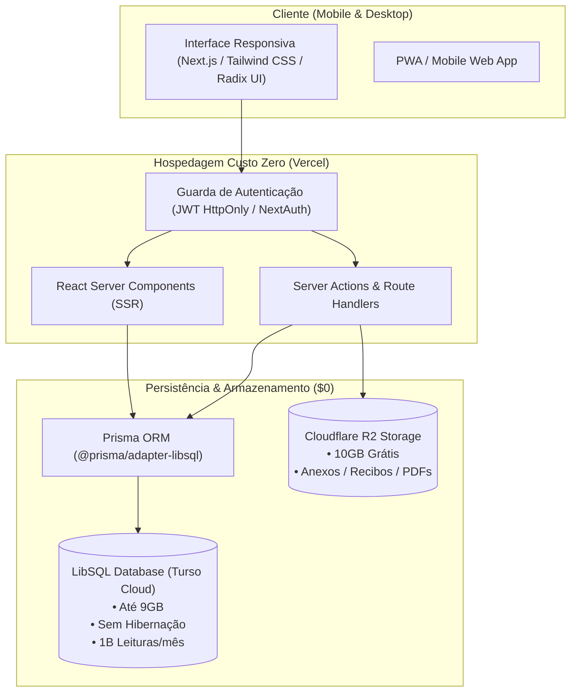
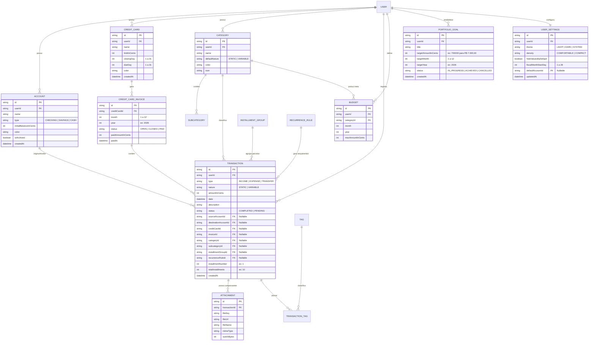
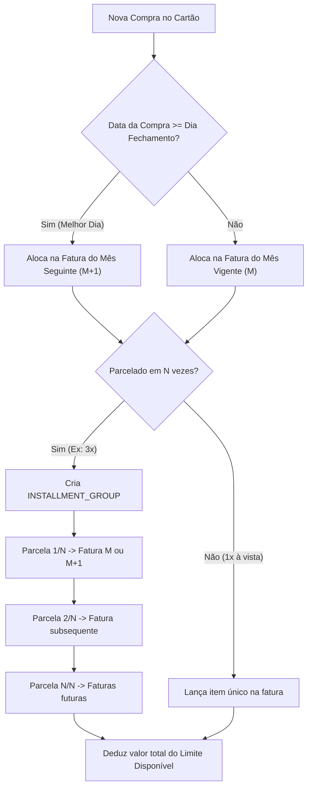

# Documento de Arquitetura de Software - Sistema Financeiro Pessoal

> **Status:** Aprovado  
> **Paradigma:** Fullstack Serverless com Next.js (App Router), Prisma & LibSQL (Turso)  
> **Custo Operacional:** R$ 0,00 / mês (Permanente)  

---

## 1. Visão Geral da Arquitetura

O sistema é construído como uma aplicação web moderna utilizando **Next.js 14+ (App Router)** e **TypeScript**, aproveitando Server Components (RSC) para renderização rápida e Server Actions / Route Handlers para mutação de dados com tipagem de ponta a ponta.

### Diagrama Arquitetural de Alto Nível



---

## 2. Decisões Tecnológicas e Justificativas

| Camada | Tecnologia | Justificativa Técnica | Custo |
| :--- | :--- | :--- | :--- |
| **Framework Fullstack** | **Next.js 14+ (App Router)** | Renderização no servidor, rotas protegidas nativas, SEO/OG e Server Actions seguras sem boilerplate de API REST separada. | \$0 (Vercel Hobby) |
| **Linguagem** | **TypeScript** | Prevenção de erros de tipagem em regras financeiras complexas (parcelas, faturas, saldo). | Grátis / Open Source |
| **Estilização & UI** | **Tailwind CSS + Lucide Icons + Shadcn/Radix** | Componentes acessíveis, visual moderno e mobile-first otimizado para telas pequenas. | Grátis / Open Source |
| **Visualização de Dados** | **Recharts** | Biblioteca declarativa e responsiva para gráficos de pizza (categorias) e barras (fluxo de caixa). | Grátis / Open Source |
| **ORM** | **Prisma ORM** | Migrations automáticas, tipagem estrita gerada e suporte oficial ao LibSQL via driver adapter. | Grátis / Open Source |
| **Banco de Dados** | **LibSQL (Turso Cloud)** | SQLite compatível distribuído. **Não suspende por inatividade** (ao contrário de Supabase/Render free), suporta até 9GB de dados e não expira. | \$0 permanente |
| **Armazenamento de Anexos** | **Cloudflare R2** | Armazenamento de objetos compatível com S3. Oferece 10GB gratuitos/mês com zero custo de tráfego de saída (egress). | \$0 permanente |
| **Autenticação** | **NextAuth / Auth.js (Credentials)** | Login único com senha protegida por bcrypt e sessão persistente em cookies seguros `HttpOnly` com `SameSite=Strict`. | \$0 |

---

## 3. Modelo de Dados e Diagrama de Entidade-Relacionamento (ERD)

Os valores monetários são estritamente modelados como **inteiros em centavos** (ex: R\$ 150,50 = `15050`) para mitigar anomalias de arredondamento causadas pela representação binária de floats no JavaScript.



---

## 4. Motor Financeiro: Metas de Carteira, Linha Estática e Comparativo MoM

### 4.1. Algoritmo da Meta de Carteira (Portfolio Goal Tracker)
Para uma meta de atingir $V_{alvo}$ (ex: R$ 7.000,00) no mês $M_{alvo}$:
1. **Patrimônio Líquido Vigente:**
   $$PL_{atual} = \sum \text{Saldo das Contas Ativas} - \sum \text{Faturas de Cartão Pendentes}$$
2. **Distância e Progresso:**
   $$\text{Progresso (\%)} = \min\left(100\%, \frac{PL_{atual}}{V_{alvo}} \times 100\right)$$
   $$\text{Distância Restante (R\$)} = \max\left(0, V_{alvo} - PL_{atual}\right)$$
3. **Ritmo Mensal Recomendado:**
   Dividir a distância restante pela quantidade de meses faltantes até a data-alvo para orientar o aporte mensal necessário.

### 4.2. Linha de Base Estática (Static Baseline)
* **Ganhos Estáticos:** Soma de receitas fixas/garantidas no mês (Salário líquido, pró-labore, aposentadoria).
* **Custos Estáticos:** Soma de despesas marcadas como `STATIC` (Aluguel, financiamento, condomínio, internet essencial).
* **Renda Livre / Discricionária:**
  $$\text{Renda Livre} = \text{Ganhos Estáticos} - \text{Custos Estáticos}$$
Permite saber exatamente quanto sobra para poupar rumo à meta ou alocar em despesas variáveis.

### 4.3. Motor de Comparação Entre Meses (Month-over-Month - MoM)
Ao confrontar o Mês Anterior ($M_{ant}$) com o Mês Vigente ($M_{atual}$):
* **Variação Percentual Global:**
  $$\Delta \% = \left(\frac{\text{Gastos}_{M_{atual}} - \text{Gastos}_{M_{ant}}}{\text{Gastos}_{M_{ant}}}\right) \times 100$$
* **Item Campeão de Despesa:**
  Query que agrupa despesas por categoria no mês e ordena `ORDER BY SUM(amountInCents) DESC LIMIT 1`, retornando a categoria que mais consumiu dinheiro (ex: Alimentação vs Peças) e a transação individual mais cara.

---

## 5. Arquitetura de Faturas e Ciclo do Cartão de Crédito

A gestão de cartão de crédito obedece ao seguinte algoritmo determinístico:



Quando a fatura é fechada e paga:
1. Uma transação do tipo `TRANSFERÊNCIA` ou `DESPESA` é gerada da conta bancária de escolha para a fatura.
2. O status da fatura muda para `PAID`.
3. O limite consumido das parcelas quitadas é restabelecido.

---

## 6. Estratégia de Deploy $0 e Persistência Permanente

### 6.1. Banco de Dados: LibSQL (Turso Cloud)
1. Instalar a CLI do Turso: `curl -sSfL https://get.tur.so/install.sh | bash`.
2. Criar o banco de dados de produção:
   ```bash
   turso db create finance-prod
   ```
3. Obter a URL e o Auth Token:
   ```bash
   turso db show --url finance-prod
   turso db tokens create finance-prod
   ```
4. O Turso fornece conexões via WebSocket/HTTP através de `@libsql/client` perfeitamente compatíveis com Serverless Functions da Vercel.

### 6.2. Hospedagem da Aplicação: Vercel
1. Conectar o repositório GitHub ao painel da Vercel.
2. Configurar as Variáveis de Ambiente no painel da Vercel:
   * `TURSO_DATABASE_URL`: `libsql://finance-prod-[user].turso.io`
   * `TURSO_AUTH_TOKEN`: `eyJhbGciOi...`
   * `NEXTAUTH_SECRET`: Chave aleatória segura de 32 bytes (`openssl rand -base64 32`)
   * `APP_ADMIN_USER`: Identificador do usuário mestre
   * `APP_ADMIN_PASSWORD_HASH`: Hash bcrypt da senha de acesso
   * `R2_ACCESS_KEY_ID`, `R2_SECRET_ACCESS_KEY`, `R2_BUCKET_NAME` (Para anexos via Cloudflare R2)
3. A cada `git push main`, a Vercel realiza a compilação e deploy atômico com certificados SSL gratuitos automáticos.

---

## 7. Estrutura Proposta de Diretórios do Projeto

```
/
├── prisma/
│   ├── schema.prisma              # Definição do schema Prisma + adapter LibSQL
│   └── migrations/                # Histórico de migrações
├── src/
│   ├── app/                       # Next.js App Router
│   │   ├── (auth)/                # Rotas públicas de login
│   │   │   └── login/page.tsx
│   │   ├── (dashboard)/           # Rotas autenticadas protegidas
│   │   │   ├── layout.tsx         # Sidebar, Header e Floating Action Button
│   │   │   ├── page.tsx           # Visão Geral (Dashboard Consolidado)
│   │   │   ├── transacoes/        # Lista e filtros de lançamentos
│   │   │   ├── contas/            # Gestão de contas bancárias e carteiras
│   │   │   ├── cartoes/           # Cartões de crédito e detalhe de faturas
│   │   │   ├── orcamentos/        # Metas de gastos e limites por categoria
│   │   │   └── relatorios/        # Gráficos de evolução temporal e balanço
│   │   ├── api/                   # Handlers REST/Uploads
│   │   │   ├── auth/[...nextauth]/route.ts
│   │   │   └── upload/route.ts    # Assinatura pré-autenticada para R2
│   │   └── globals.css
│   ├── actions/                   # Server Actions (Mutação de dados tipada)
│   │   ├── transactions.ts        # createTransaction, updateTransaction, etc.
│   │   ├── accounts.ts            # createAccount, updateAccount
│   │   ├── cards.ts               # createCard, payInvoice
│   │   └── budgets.ts             # setBudget, checkBudgetLimits
│   ├── components/                # Componentes reutilizáveis
│   │   ├── ui/                    # Botões, Modais, Inputs, Tooltips (Radix)
│   │   ├── cards/                 # Cards de Resumo Financeiro
│   │   ├── forms/                 # Modais de Nova Transação, Nova Conta
│   │   ├── charts/                # Gráficos Recharts (Categorias, Mensal)
│   │   └── layout/                # Sidebar, BottomNav (mobile)
│   ├── lib/                       # Utilitários globais
│   │   ├── prisma.ts              # Conexão singleton Prisma + LibSQL client
│   │   ├── currency.ts            # Formatadores monetários (BRL / centavos)
│   │   ├── date-helpers.ts        # Regras de fechamento e vencimento de faturas
│   │   └── r2.ts                  # Cliente S3 / Cloudflare R2
│   └── types/                     # Interfaces TypeScript compartilhadas
├── REQUIREMENTS.md                # Requisitos Funcionais e Regras de Negócio
└── ARCHITECTURE.md                # Este documento de arquitetura
```
