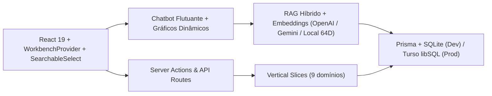

# FinMind — Gestão Financeira Pessoal & Copiloto IA

Aplicação full-stack de gestão financeira pessoal construída com **Next.js 15 (App Router)**, **React 19**, **TypeScript estrito**, **Tailwind CSS**, **Prisma ORM** e **SQLite / Turso (libSQL)** — projetada para operar com **custo R\$ 0,00/mês**, privacidade local/pessoal e assistência inteligente baseada nos seus dados reais (RAG).

---

## Principais Funcionalidades

- **Visão Geral & Destaques do Mês:** saldo consolidado, receitas/despesas, evolução de 6 meses, distribuição por categoria, categoria campeã, item mais caro e proporção entre custos fixos e variáveis.
- **Comparativo Entre Meses:** comparação lado a lado de quaisquer dois meses com barras proporcionais, variação em reais/percentual e tabela detalhada por categoria.
- **Metas de Carteira, Metas Juntas & Custos Estáticos:**
  - Ritmo mensal calculado a partir da linha de base fixa (`Ganhos Estáticos − Custos Estáticos`).
  - **Metas Juntas (Projeção Consolidada + Simulador):** soma todas as metas e calcula o tempo total simulando outros ganhos e outros custos mensais ou pontuais.
  - Separação clara entre **Regras Fixas Mensais (Planejado)** (com status *Já caiu no mês* / *Aguardando*) e **Lançamentos Fixos Já Caídos no Mês (Extrato)**.
  - Orçamentos por categoria e CRUD completo de categorias personalizadas.
- **Previsão de Valor & Verificação por Data:** cadastro de ganhos previstos (`Vou Ganhar`) e prováveis gastos (`Provável Gasto`), além de **Metas de Saldo por Data** que verificam automaticamente quando o dia chega se o saldo real ficou **igual**, **maior** ou **menor** que o planejado.
- **Contas, Cartões de Crédito & Faturas:** múltiplas contas, transferências, calibração de saldo, parcelamentos automáticos e quitação de faturas.
- **Extrato, Filtros Combinados & Comprovantes:** busca por texto/`#tag`, filtros com **Select pesquisável customizado** em toda a aplicação, anexos de recibos/comprovantes e exportação CSV.
- **Importação & Conciliação Inteligente de Extratos:** upload simultâneo de **CSV, OFX, XLSX, PDF e TXT** (ou texto colado), detecção de duplicidades, memória de aprendizado, calibração de saldo pelo banco e histórico auditável com detecção de lotes duplicados, paginação e reversão controlada.
- **Chatbot Flutuante IA com RAG, Histórico Persistido e Gráficos Dinâmicos:** acessível no canto inferior direito em qualquer tela, consulta seus dados reais no banco via RAG híbrido, salva histórico completo de conversas e renderiza gráficos Recharts dinâmicos (KPIs, Donut, Barras 6 meses e Progresso de Metas).
- **Multi-Provedor Dinâmico (OpenAI, Google Gemini e Anthropic Claude):** descoberta ao vivo dos modelos liberados na conta do usuário em `/api/ai/models` e teste interativo em tempo real.
- **Backup & Segurança:** **Snapshot Completo (Exportar & Importar pareado)**, reset seletivo (*apenas valores* ou *tudo do zero* com dupla confirmação), sessão JWT HttpOnly, chaves de IA criptografadas com AES-256-GCM e modo privacidade (ocultar valores).

---

## Arquitetura (Resumo)

O projeto utiliza **Monólito Modular por Vertical Slices** (`src/features/*` + `src/shared/*`), mantendo 100% dos arquivos de código com **≤ 250 linhas** e zero `any`.



### Documentação Técnica Completa (`docs/`)
1. [**`docs/ARCHITECTURE.md`**](docs/ARCHITECTURE.md) — Padrão arquitetural, estrutura de pastas, fluxo de dados, ERD, segurança e roadmap do que podemos melhorar.
2. [**`docs/AI_AND_RAG.md`**](docs/AI_AND_RAG.md) — Diagramas completos do uso da IA, pipeline de Embeddings (`FinancialKnowledgeChunk`), busca híbrida RAG, gráficos dinâmicos e conciliação de extratos.
3. [**`docs/DEPLOY_VERCEL_TURSO.md`**](docs/DEPLOY_VERCEL_TURSO.md) — Passo a passo de publicação gratuita na Vercel com banco Turso (libSQL) e migração via Snapshot.

---

## Como Executar Localmente

> Este projeto utiliza exclusivamente **`pnpm`**.

```bash
# 1. Instale as dependências
pnpm install

# 2. Crie o arquivo de ambiente
cp .env.example .env

# 3. Sincronize o schema Prisma com o SQLite local
pnpm db:push

# 4. Inicie o servidor de desenvolvimento
pnpm dev
```

Acesse `http://localhost:3000`.

---

## Scripts Disponíveis (`pnpm`)

| Comando | Descrição |
| :--- | :--- |
| `pnpm dev` | Inicia o servidor de desenvolvimento Next.js |
| `pnpm build` | Gera Prisma Client e compila o build de produção |
| `pnpm start` | Inicia o build de produção compilado |
| `pnpm lint` | Executa ESLint estrito em `src/` e `tests/` |
| `pnpm test` | Executa toda a suíte unitária e de integração (Vitest) |
| `pnpm test:coverage` | Executa Vitest com relatório de cobertura V8 |
| `pnpm test:e2e` | Executa todos os testes End-to-End no Chromium (Playwright) |
| `pnpm verify` | Pipeline completo: Typecheck + Lint + Vitest + Build + Playwright E2E |
| `pnpm db:push` | Sincroniza o schema Prisma no SQLite local |
| `pnpm db:push:turso` | Aplica o schema Prisma (DDL idempotente) no banco remoto Turso libSQL |
| `pnpm db:studio` | Abre o Prisma Studio para inspeção visual do banco local |

---

## Extratos de Exemplo para Testes
Na pasta [`exemplos-extratos/`](exemplos-extratos/) há 3 extratos realistas (Nubank CSV, Itaú OFX e Mercado Pago CSV) com um resumo de conferência centavo a centavo em [`RESUMO_CONFERENCIA.md`](exemplos-extratos/RESUMO_CONFERENCIA.md) para testar a conciliação e a detecção de duplicidades.
