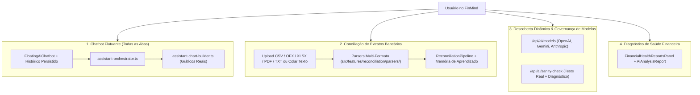
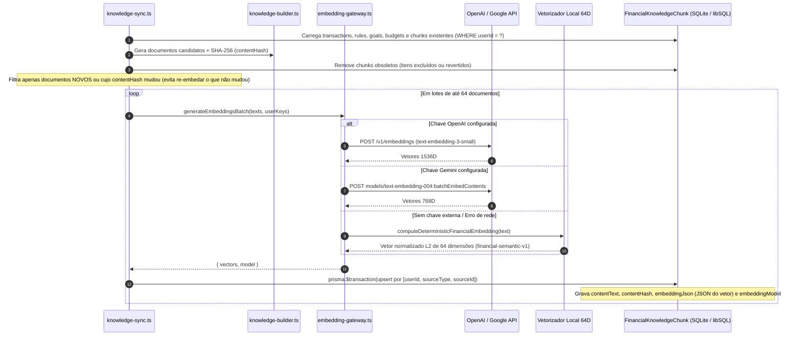
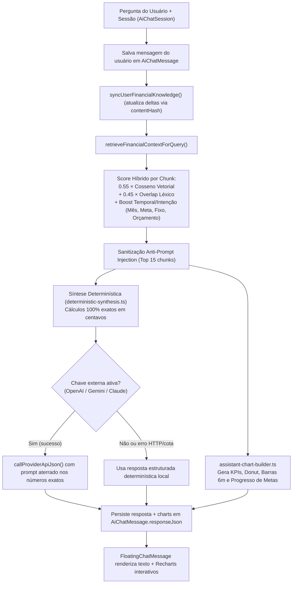

# Inteligência Artificial, RAG, Embeddings e Processamento de Dados — FinMind

> Este documento explica em detalhe **onde a IA é utilizada**, **como os dados financeiros são processados**, **como os embeddings são gerados e salvos no banco** e **como o assistente responde sem alucinar valores**.

---

## 1. Onde a IA Atua na Aplicação

A IA atua em **4 fluxos independentes**, todos com fallback seguro caso não haja chave externa configurada:

---

## 2. Pipeline de Embeddings & Salvamento no Banco (RAG)

O sistema mantém uma tabela dedicada no banco de dados: **`FinancialKnowledgeChunk`** (`prisma/schema.prisma`), estritamente isolada por `userId`.

### O que é indexado?
Em `src/features/ai-copilot/rag/knowledge-builder.ts`, o FinMind converte os registros reais do usuário em documentos textuais ricos em contexto financeiro:
- **Lançamentos (`TRANSACTION`)** — até os 800 mais recentes (descrição, valor em BRL, categoria, conta/cartão, contraparte, finalidade, natureza fixa/variável e data).
- **Regras Fixas (`RECURRENCE_RULE`)** — ganhos e custos estáticos mensais ativos.
- **Metas de Carteira (`PORTFOLIO_GOAL`)** — valor alvo, prazo e observações.
- **Orçamentos (`BUDGET`)** — teto mensal por categoria.

### Como os Embeddings são gerados e salvos?

### Detalhe do Vetorizador Local Determinístico (`financial-semantic-v1` — 64 dimensões)
Quando o usuário usa Claude (que não possui endpoint de embeddings) ou opera sem chave de API externa, `rag-math-and-security.ts` gera um vetor L2-normalizado de 64 floats:
- **Dimensões `0..20`:** taxonomia de finalidade financeira (`HOUSING_RENT`, `SALARY_COMPENSATION`, `GROCERY_SUPERMARKET`, `EDUCATION`, `SUBSCRIPTION_STREAMING`, etc.).
- **Dimensões `21..25`:** direção e natureza (receita, despesa, transferência, estático, variável).
- **Dimensões `26..31`:** entidades de planejamento (meta, orçamento, cartão/fatura, meio de pagamento).
- **Dimensões `32..63`:** feature hashing de tokens significativos (ignorando stopwords em português).

---

## 3. Recuperação Híbrida, Gráficos Dinâmicos e Resposta Sem Alucinação

Quando o usuário envia uma mensagem no **Chatbot Flutuante** (`sendAiChatMessageAction` → `executeContextualFinancialAssistant`):

### Garantias de Precisão e Confiabilidade
1. **Isolamento Multi-Tenant:** todas as queries RAG filtram obrigatoriamente por `where: { userId }`.
2. **Gráficos 100% Reais:** os dados dos gráficos dinâmicos (`kpi_strip`, `donut`, `bar_comparison`, `progress_bars`) são construídos diretamente no servidor por `assistant-chart-builder.ts` a partir do banco — o LLM **nunca inventa números de gráfico**.
3. **Separação Estrutural:** cada resposta separa explicitamente **Fatos Históricos**, **Cálculos Exatos**, **Projeções & Estimativas** e **Recomendações Práticas**, exibindo as fontes consultadas.
4. **Histórico Persistido:** cada nova conversa grava uma `AiChatSession` com título automático e salva todas as mensagens (`AiChatMessage`) incluindo o JSON completo da resposta e dos gráficos, permitindo reabrir e consultar depois.

---

## 4. Pipeline de Processamento de Extratos Bancários

```mermaid
flowchart LR
  Files["Arquivos: CSV, OFX, XLSX, PDF, TXT<br/>ou Texto Colado"]
  Detect["Detecção de Banco & Formato<br/>(statement-detectors.ts)"]
  Parse["Extração Estruturada<br/>(unpdf / xlsx / csv / ofx)"]
  Norm["Normalização de Datas, Centavos<br/>e Hash Externo (Deduplicação)"]
  Sem["Classificação Semântica +<br/>Memória Aprendida (ReconciliationMemoryRule)"]
  Match["Conciliação com Regras Fixas<br/>e Lançamentos Existentes"]
  Review["Tela de Revisão Humana<br/>(Edição, Filtros e Calibração de Saldo)"]
  Commit["Commit Atômico em prisma.$transaction<br/>(StatementImportBatch + Transactions)"]
  Audit["Histórico com Detecção de Duplicados,<br/>Paginação e Reversão Controlada"]

  Files --> Detect --> Parse --> Norm --> Sem --> Match --> Review --> Commit --> Audit
```

---

## 5. Descoberta Dinâmica de Modelos de IA

A rota `/api/ai/models` consulta ao vivo os modelos liberados para a chave do usuário nos 3 provedores:
- **OpenAI:** `GET https://api.openai.com/v1/models` (filtra modelos de chat/raciocínio `gpt-*`, `o1*`, `o3*`, `o4*`, `chatgpt-*` e exclui áudio/embedding/imagem).
- **Google Gemini:** `GET https://generativelanguage.googleapis.com/v1beta/models` (filtra modelos com suporte a `generateContent`).
- **Anthropic Claude:** `GET https://api.anthropic.com/v1/models` (lista modelos Claude ativos na conta).

Qualquer novo modelo descoberto dinamicamente é resolvido automaticamente em `models-catalog.ts` sem precisar atualizar código estático.

---

## 6. Agente IA Autônomo, Visual e Contextual (`src/features/ai-agent/`)

O FinMind evoluiu o assistente para um **Agente Autônomo Interativo** integrado à interface, com separação em 6 camadas:

1. **Base de Conhecimento Versionada (`docs/knowledge/*.md`) + RAG Dual:**
   - Documentos modulares em Markdown (telas, fluxos, regras de negócio, validações e erros) indexados por SHA-256 nas tabelas `SystemKnowledgeDocument` e `SystemKnowledgeChunk` (`pnpm kb:validate` / `pnpm kb:sync`).
   - Busca híbrida (cosseno vetorial + BM25 léxico + boost pela aba ativa) combinada ao `FinancialKnowledgeChunk` isolado por `userId`.
2. **Percepção da Interface (`UiStateSnapshot`) & Registro Semântico (`data-agent-id`):**
   - Cada turno envia aba ativa, período, modal aberto, filtros, tema e alvos montados no DOM (`agent-target-registry.ts`), sem depender de coordenadas fixas ou seletores frágeis.
3. **Tool Calling Multi-Provedor (`agent-tool-provider-client.ts`):**
   - Suporte nativo a chamadas de ferramentas em **OpenAI**, **Google Gemini** e **Anthropic Claude**, com roteamento determinístico seguro de fallback.
4. **Interação Visual Interrompível (`AgentVisualStage`):**
   - Cursor virtual com trajetória curva Bézier (`AiVirtualCursor`), destaque luminoso contextual (`AiElementSpotlight`), rolagem suave e pílula de controle (`Pausar` / `Parar Esc` + interrupção automática ao clicar fora).
   - 3 modos selecionáveis no cabeçalho do chat: **Visual** (padrão), **Guiado** (ensina sem salvar) e **Rápido**.
5. **Captura Real e Anotação de Telas (`modern-screenshot` + `CanvasAnnotator`):**
   - Captura o estado real renderizado da interface (tema, dados e modais atuais), oculta automaticamente elementos sensíveis (`data-agent-sensitive`) ou respeita o Modo Privacidade, e desenha caixas de destaque e etapas numeradas exibidas inline no chat com zoom.
6. **Governança, Confirmação Prévia, Verificação e Rollback (`AgentActionAuditLog`):**
   - Matriz de risco `L0`/`L1` (imediato), `L2`/`L3` (confirmação prévia com diff *Antes → Depois*, idempotência, verificação real no banco pós-persistência e botão **Desfazer**) e `BLOCKED` (Reset Geral e credenciais bloqueados para execução autônoma).
