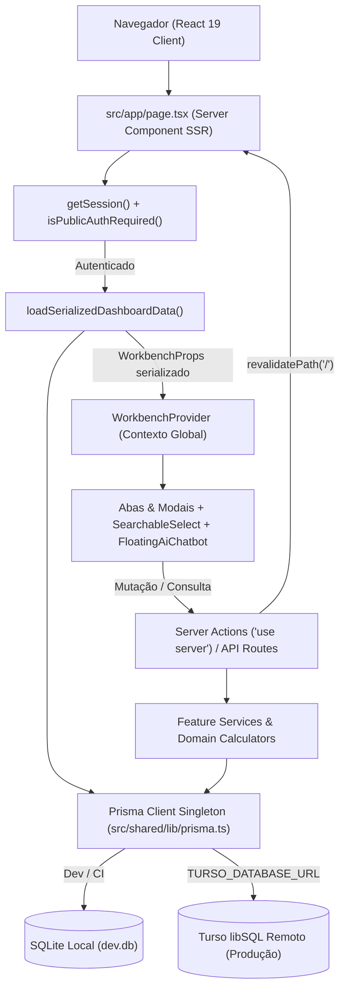
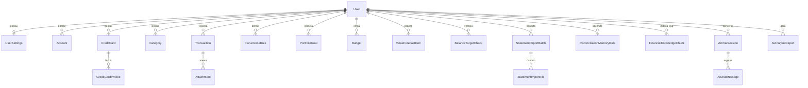

# Arquitetura do Sistema — FinMind

> Documentação oficial da arquitetura, padrões adotados, fluxo de dados, modelo de persistência, segurança e roadmap técnico de evolução do **FinMind**.

---

## 1. Padrão Arquitetural Adotado

O FinMind segue o padrão **Monólito Modular orientado a Vertical Slices (Feature-First)** sobre **Next.js 15 App Router (Full-Stack Serverless)**.

### Por que Monólito Modular (Vertical Slices)?
- **Coesão de domínio:** tudo que pertence a uma capacidade de negócio (`transactions`, `planning`, `reconciliation`, `ai-copilot`, etc.) vive isolado na mesma pasta (`domain/`, `services/`, `actions/`, `hooks/`, `components/`).
- **Custo operacional zero:** uma única unidade de deploy na Vercel conectada a um banco **Turso (libSQL)** gratuito, sem necessidade de microserviços, filas pagas ou bancos vetoriais dedicados.
- **Baixa complexidade cognitiva e alta testabilidade:** lógica matemática e regras de negócio ficam em funções puras em `domain/` (testáveis com Vitest sem banco), persistência e transações ficam em `services/` (testáveis contra SQLite real em testes de integração), e a interface fica em `components/` + `hooks/` (validada com Playwright E2E).
- **Disciplina de modularidade:** 100% dos arquivos em `src/` e `tests/` são mantidos estritamente **≤ 250 linhas**, com `@typescript-eslint/no-explicit-any: "error"`.

---

## 2. Estrutura de Pastas

```text
FinMind/
├── docs/                          # Documentação técnica oficial
│   ├── ARCHITECTURE.md            # Este documento (arquitetura, dados, melhorias)
│   ├── AI_AND_RAG.md              # Diagramas e fluxo detalhado de IA, RAG e Embeddings
│   └── DEPLOY_VERCEL_TURSO.md     # Guia de deploy gratuito (Vercel + Turso libSQL)
├── prisma/
│   └── schema.prisma              # 19 modelos SQLite / libSQL (Prisma ORM)
├── scripts/
│   └── push-turso-schema.mjs      # Sincronização idempotente do DDL no Turso remoto
├── src/
│   ├── app/                       # Next.js 15 App Router (SSR, Error Boundary e API Routes)
│   │   ├── page.tsx               # Entrada SSR autenticada -> loadSerializedDashboardData()
│   │   ├── error.tsx              # Error Boundary global
│   │   ├── sso-popup/page.tsx     # Fluxo popup de conexão oficial de chave dos provedores IA
│   │   └── api/
│   │       ├── ai/models/         # Descoberta dinâmica de modelos (OpenAI, Gemini, Anthropic)
│   │       ├── ai/sanity-check/   # Validação em tempo real de credenciais e modelos
│   │       ├── export/            # Exportação CSV (RFC 4180) e Backup JSON
│   │       ├── snapshot/          # Snapshot completo (Exportar & Restaurar pareado)
│   │       └── sso/               # Gestão segura de credenciais de provedores IA
│   ├── features/                  # 9 Vertical Slices de domínio
│   │   ├── accounts/              # Contas bancárias, saldos e transferências
│   │   ├── ai-copilot/            # Chatbot flutuante, histórico, gráficos, RAG, provedores
│   │   ├── analytics/             # Visão Geral, Destaques, Comparativo e Dashboard Loader
│   │   ├── auth/                  # Sessão JWT HttpOnly, criptografia AES-256-GCM e Reset
│   │   ├── credit-cards/          # Cartões, faturas mensais e parcelamentos
│   │   ├── dashboard/             # WorkbenchProvider, Header, Modais globais e Snapshot
│   │   ├── planning/              # Metas, Metas Juntas, Regras Estáticas, Orçamentos e Previsão de Valor
│   │   ├── reconciliation/        # Parsers (CSV/OFX/XLSX/PDF/TXT), conciliação e auditoria
│   │   └── transactions/          # Extrato, filtros, anexos e exportação
│   └── shared/                    # Primitivos transversais reutilizáveis
│       ├── charts/                # Gráficos Recharts do dashboard
│       ├── icons/                 # Catálogo e inferência semântica de ícones
│       ├── lib/                   # Prisma/libSQL singleton, moeda BRL, logger, DDL Turso
│       ├── types/                 # Contratos ActionResult
│       └── ui/                    # Design System (Button, Modal, Input, SearchableSelect, Badge)
├── tests/
│   ├── unit/                      # Testes puros de matemática, parsers, RAG e descoberta IA
│   ├── integration/               # Testes reais contra Prisma/SQLite + API Routes
│   └── e2e/                       # Fluxos completos no navegador real (Playwright)
├── vercel.json                    # Configuração pnpm + Next.js para Vercel
└── .github/workflows/ci.yml       # Pipeline CI automatizado (lint, typecheck, test, build, E2E)
```

---

## 3. Fluxo de Dados End-to-End



### Regras de Fluxo de Dados
1. **Leitura inicial via SSR (`page.tsx` → `dashboard-data-loader.ts`):** elimina cascatas de `useEffect` no cliente; todas as métricas são calculadas no servidor em paralelo (`Promise.all`) com valores monetários sempre em **centavos inteiros (`Int`)** para evitar erros de ponto flutuante.
2. **Estado global sem prop-drilling:** `WorkbenchProvider` (`src/features/dashboard/context/workbench-context.tsx`) centraliza estado de abas, modais ativos, privacidade (`hideValues`), tema, filtros e confirmação de exclusão.
3. **Escritas sempre no servidor:** toda mutação passa por **Server Actions** ou **Route Handlers**, valida autenticação via `requireAuthenticatedUser()`, executa operações críticas dentro de `prisma.$transaction(...)` e dispara `revalidatePath('/')`.

---

## 4. Modelo de Dados (Visão Geral das 19 Entidades)



---

## 5. Stack Tecnológica & Segurança

| Camada | Tecnologia | Papel |
| :--- | :--- | :--- |
| **Framework** | Next.js 15 (App Router) + React 19 | SSR, Server Actions, API Routes e roteamento |
| **Linguagem** | TypeScript 5.8 (Strict) | Tipagem estrita com `no-explicit-any: error` |
| **Estilização** | Tailwind CSS 3 + Lucide React | Design System responsivo claro/escuro |
| **Visualização** | Recharts 2.15 | Gráficos do dashboard e gráficos dinâmicos no chat IA |
| **ORM & Banco** | Prisma 6 + `@prisma/adapter-libsql` | SQLite local (dev/CI) e Turso libSQL gratuito (prod) |
| **Validação** | Zod 4 | Validação de snapshots, ações e payloads de API |
| **Parsers** | `unpdf`, `xlsx` + parsers nativos CSV/OFX/TXT | Leitura multi-formato de extratos bancários |
| **Segurança** | `jose` (JWT HS256), `bcryptjs`, `AES-256-GCM` | Sessão HttpOnly, hash de senha e chaves de IA criptografadas |
| **Testes** | Vitest 5 (Unit + Integration) + Playwright (E2E) | Pirâmide completa de testes automatizados |
| **Pacotes** | `pnpm@12.15.0` | Lockfile determinístico e build rápido |

### Controles de Segurança Implementados
- **Autenticação obrigatória em URL pública (`isPublicAuthRequired()`):** ativa automaticamente quando `VERCEL=1` ou `REQUIRE_AUTH=true`.
- **Criptografia em repouso (`secret-crypto.ts`):** chaves de API de OpenAI, Gemini e Anthropic são encriptadas com **AES-256-GCM** (chave derivada de `AUTH_SECRET`) antes de gravar em `UserSettings`.
- **Anti-Prompt Injection (RAG):** todo chunk recuperado do banco passa por `sanitizeRetrievedContentAgainstPromptInjection()` antes de entrar no prompt do LLM.
- **Anti-Formula Injection (CSV):** células iniciando com `=`, `+`, `@` são escapadas em `escapeCsvCell()`.
- **Snapshot seguro:** exportação exclui `passwordHash` e chaves de API; importação remapeia todos os IDs dentro de uma transação atômica (`prisma.$transaction`).

---

## 6. O Que Podemos Melhorar (Roadmap Técnico de Evolução)

Para facilitar sua visualização do que evoluir nas próximas iterações:

| Área | Situação Atual | Melhoria Recomendada | Impacto |
| :--- | :--- | :--- | :--- |
| **Busca Vetorial (RAG)** | Vetores salvos em `embeddingJson` (`TEXT`) e similaridade de cosseno calculada em memória (Node.js) por usuário. Excelente até ~5.000 chunks/usuário. | Migrar para vetor nativo do Turso/libSQL (`F32_BLOB` + `vector_top_k`) quando o histórico ultrapassar milhares de lançamentos. | Escala e menor uso de memória serverless |
| **Sincronização RAG** | `syncUserFinancialKnowledge()` roda sob demanda a cada pergunta no chat (com cache via `contentHash` SHA-256). | Disparar reindexação incremental apenas para o registro alterado nas mutations de transação/meta/regra. | Latência menor na primeira pergunta do chat |
| **Migrações de Banco** | `db:push` local e `pnpm db:push:turso` (DDL idempotente `CREATE IF NOT EXISTS`). | Adotar migrações versionadas (`prisma migrate deploy`) se o schema começar a ter alterações destrutivas de colunas em produção. | Evolução segura de colunas em produção |
| **Dashboard SSR** | `loadSerializedDashboardData()` carrega todas as abas de uma vez na entrada (`/`). | Dividir carregamento pesado de abas secundárias (ex.: histórico completo de lotes de conciliação) sob demanda via Server Actions/Route Handlers. | TTFB ainda mais rápido com grandes volumes |
| **Observabilidade** | Logger estruturado em console (`src/shared/lib/logger.ts`). | Integrar telemetria leve (ex.: Sentry free tier ou Vercel Analytics) em produção. | Rastreamento proativo de erros em produção |
| **Multi-usuário / Cadastro** | Modo de uso pessoal com administrador inicial + isolamento completo por `userId` em todas as queries. | Caso queira abrir para mais pessoas (família/SaaS), adicionar fluxo de convite/cadastro e troca de senha na tela de Configurações. | Expansão de uso pessoal para multi-usuário |
